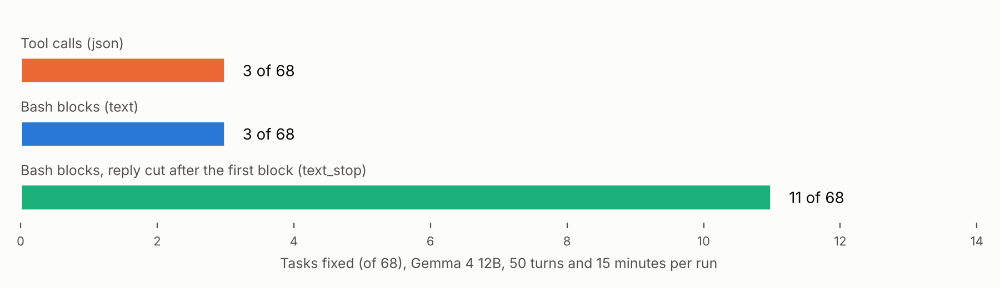
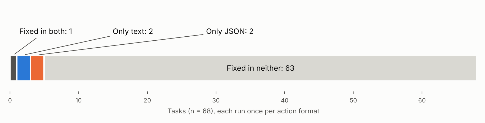

# Same model, same bugs, two formats

**Subtitle (140 characters max on Kaggle):** Gemma 4 12B fixed 3 of 68 bugs with tool calls and 3 with bash blocks. Cutting the text reply after its first command fixed 11.

## Abstract

I ran one small agent loop on the competition's public bug-fix tasks, once with Gemma 4 12B calling tools through the server's tool-call interface and once with the same model writing one fenced `bash` block per turn. The model file, server settings, prompt (apart from one line), budget and checker were the same. On 68 tasks each format fixed 3. So the format, on its own, did not change how many bugs got fixed. It changed how the budget was spent. Format errors were rare in both arms (30 of 2,403 turns with tool calls, 4 of 637 with bash blocks). With bash blocks the model kept writing after its command in 141 of 637 turns, and those turns took 79% of its output tokens. With tool calls the model stopped producing thinking text: all 68 first turns had some, and 1,221 of 1,418 turns from turn 16 onward had none. A third arm, added after the pilot, keeps the bash-block format and cuts the reply as soon as the first block is complete. It fixed 11 of 68, against 3 for the uncut text arm (8 tasks to 0 where they disagree, exact sign test p = 0.008). That arm ran in separate notebooks on one seed, so I report it as a lead to confirm.

| 68 tasks, one run per arm | Tool calls (`json`) | Bash blocks (`text`) | Bash blocks, reply cut after first block (`text_stop`) |
|---|---|---|---|
| Tasks fixed | 3 | 3 | 11 |
| Malformed turns | 30 of 2,403 | 4 of 637 | 7 of 1,380 |
| Turns that ran to the output cap | 23 | 141 | 7 |
| Turns with no thinking text | 1,442 of 2,403 | 2 of 637 | 40 of 1,380 |

For someone choosing how to build an agent on Gemma 4: the action format did not show up as broken syntax. It showed up as a turn that doesn't end (text) or a model that stops thinking (tool calls), and the loop has to handle whichever one it gets.



## 1. Introduction

The competition's harness, `swegemma`, gives the agent tools and reads the model's actions as tool calls. The other common design lets the model write a shell command in plain text and picks it out with a pattern, as mini-SWE-agent and CodeAct-style agents do [1, 2, 3].

A common belief is that local models do better with text actions, because structured calls break. The closest test I found is by ai-muninn: Gemma 4 26B made more than 40 tool-calling errors in OpenHands, which registers 11 tools, and fixed a bug in 9 steps in SWE-agent, which uses text commands [4]. That was one simple bug, with the whole framework swapped, and the author calls it a "feasibility test, not a full benchmark". The same author's later run of 116 of 300 on SWE-bench Lite credits a "backticks protocol instead of tool_calls" as one of three things that mattered [5].

This paper changes only the format and counts. With the same model, tasks, prompt and budget, does Gemma 4 fix more bugs when it writes its action as a `bash` block than as a tool call?

## 2. Method

### 2.1 Tasks and checker

The tasks are the competition's 129 public ones, from fastapi, rich, requests and httpx. I started from the 114 that dmitriigluzdov's `task_soundness.csv` marks as sound [6] and put them in a fixed order, sorted by the SHA-256 of the task id. The order was in the notebook before any run, so no task was picked by looking at results.

Workspaces and grading are the host's. Each run gets a fresh workspace built by `swegemma`'s own setup functions, in its subprocess sandbox, as in the starter notebook. The patch is the workspace's `git diff` against the baseline, with test files stripped by `swegemma`'s `strip_protected_files_from_patch`. A task counts as fixed only if `swegemma`'s `verify_task` says so.

Before a task is run, the same notebook checks the checker on it: `verify_task` must pass the task's reference patch and fail the empty patch. If it doesn't, the task is skipped and listed in `controls.csv`. The gate passed 68 of 114 tasks: rich 39 of 44, fastapi 29 of 62, requests 0 of 7, httpx 0 of 1. Of the 46 dropped, 45 have a reference patch that doesn't pass in my environment (Kaggle's subprocess sandbox, without the per-repository dependency repairs that [6] describes) and 1 passes with the empty patch. A task that fails this check can't be scored, so it is left out. All four notebooks picked the same 68.

### 2.2 The loop

The agent has one capability: run a shell command in the workspace. Reading, searching, editing and testing all go through it. It can also say it is done.

Each turn, the reply is read for an action. If there is one, the command runs, and its exit code and output go back, cut to 4,000 characters. If there is none, the turn counts as malformed and a fixed correction message goes back. If the reply holds several actions, only the first runs, and the model is told. A run stops when the model submits, after 50 turns, or after 15 minutes.

### 2.3 The arms

- **`json`**: the request carries two tool definitions, `run_command(command)` and `submit()`. vLLM's `gemma4` tool-call parser turns the model's tool-call tokens into structured calls. A turn is usable if the first call names one of the two tools and its arguments parse into an object with a non-empty `command`. Gemma 4 emits its own tool-call tokens and the server converts them; I call the arm `json` because JSON is what the agent builder reads, as in the competition's harness.
- **`text`**: no tools are sent. The model is told to write one fenced block that starts with ```` ```bash ````. A turn is usable if the reply contains such a block, and the first one is the action. A block holding only the word `submit` ends the run.
- **`text_stop`** (added after the pilot, see 2.5): the `text` arm with the same prompt and one change in the code that reads the reply. The reply is streamed and the connection is closed as soon as the first complete `bash` block has arrived.

The `json` and `text` system prompts differ in one line, the paragraph that says how to write an action. The notebook asserts this and saves the diff (`prompt_diff.txt`). The user message, the correction message and the format of command output come from the same code in every arm. One difference comes with the format: command output returns as a tool message in `json` and as a user message in the text arms.

### 2.4 Settings

Model: `gemma-4-12b-it-qat-w4a16-ct`, untuned, one of the four the competition allows. Server: vLLM as set up in the host's starter notebook (context 32,768 tokens, `tool_call_parser` and `reasoning_parser` both `gemma4`), on Kaggle's 4× L4. Sampling as in the host's sample submission: temperature 0.2, top-p 0.95, thinking on with a 4,096-token budget. Output cap 6,144 tokens per turn. Seed 0. Thinking text is not sent back in later turns, in any arm.

The `json` and `text` runs of a task start together against the same server, with 20 runs in flight, so the two arms see the same load. `text_stop` ran afterwards in notebooks of its own, also with 20 runs in flight. Per run, the server produced 20.6 output tokens per second in `json`, 21.2 in `text` and 22.9 in `text_stop`.

### 2.5 What changed after the pilot

A 10-task pilot with 30 turns and 5 minutes fixed nothing in either arm. It showed the reference patch failing on 5 of its 10 tasks, and the text arm running to the output cap in 7 of 71 turns. Before the main run I raised the budget to 50 turns and 15 minutes for all arms, added the checker gate, and added the `text_stop` arm. Nothing was changed after seeing main-run results.

## 3. Results

204 runs: 68 tasks in three arms. No harness errors, no missing rows.

### 3.1 Tool calls against bash blocks: no difference in bugs fixed

`json` fixed 3 of 68 and `text` fixed 3 of 68. One task was fixed by both, two only by `json`, two only by `text`, 63 by neither. An exact sign test on the four disagreements gives p = 1.0.



Both counts are low. This loop is bare on purpose: one tool, no edit helper, no code graph. With 3 fixes per arm, the comparison could only have detected a large difference, and it found none.

### 3.2 Format errors are rare in every arm

Malformed turns: 30 of 2,403 in `json` (1.2%), 4 of 637 in `text`, 7 of 1,380 in `text_stop`. Of the 30 in `json`, 23 were replies that hit the output cap before any tool call and 7 were replies with no tool call. No turn had an unknown tool name or arguments that failed to parse. No run in any arm was "stuck on format" (half or more of its turns malformed).

So the belief that structured calls break did not hold here. The setting differs from the reports behind that belief: two tools, where [4] and [5] describe failures with 10 or more registered, and the server's own `gemma4` parser with the host's settings.

### 3.3 What the format changed

**Bash blocks: the turn does not end.** In 141 of 637 `text` turns (22%) the reply ran to the 6,144-token cap, against 23 of 2,403 in `json`. Those 141 turns took 866,304 of the arm's 1,099,072 output tokens (79%), and they happened in 65 of 68 tasks. In 153 turns the reply held more than one `bash` block. In the 7 cut-off text turns of the pilot, whose transcripts I read (a reading, not a count), after its first command the model either wrote dozens more commands (46, 78 and 279 blocks in three replies) or wrote the command's output itself, a traceback or a grep listing that never happened, and carried on from it. A tool call ends the turn by construction. A code fence doesn't.

The cost is time: 65 of 68 `text` runs hit the 15-minute limit, after a median of 7.5 turns.

**Tool calls: the thinking goes away.** Thinking was on in every arm with the same budget. In `text`, 635 of 637 turns had thinking text. In `json`, all 68 first turns did, but 1,442 of 2,403 turns overall had none, and from turn 16 onward 1,221 of 1,418 had none. The median `json` turn was 38 output tokens: a tool call and nothing else. The arm ran 1,277 `grep` and 518 `cat` commands, hit the 50-turn limit in 32 of 68 runs, and in 20 of those left no patch.

I can't tell from this data whether that is the model's habit after tool results or an effect of the chat template or the reasoning parser. It is what an agent builder gets with the competition's server settings, and it matters because public work on these tasks reports 23 solved with thinking off against 48 to 51 with it on [7].

Two tasks show both patterns. On `fastapi_14458`, `json` searched, edited, checked with Python and submitted at turn 21; `text` got 6 turns in 15 minutes because 4 of them ran to the cap, and its patch failed. On `fastapi_14786`, `json` ran 50 `cat` commands, the last 39 without thinking, and hit the turn limit with a patch that failed; `text` had a working patch by turn 6 despite two run-on turns of 513 and 262 seconds.

### 3.4 Cutting the reply after the first block

`text_stop` removes the run-on turns without touching the prompt. It fixed 11 of 68.

| | `json` | `text` | `text_stop` |
|---|---|---|---|
| Tasks fixed | 3 | 3 | 11 |
| Turns per task (median) | 45 | 7.5 | 19 |
| Turns with no thinking text | 1,442 of 2,403 | 2 of 637 | 40 of 1,380 |
| Turns that ran python or pytest | 79 | 26 | 98 |
| Turns that changed the workspace | 74 | 31 | 99 |
| Runs that left a patch | 25 | 18 | 34 |
| By repository: rich (39 tasks) | 1 | 0 | 6 |
| By repository: fastapi (29 tasks) | 2 | 3 | 5 |

Against `text`: 8 tasks fixed only by `text_stop`, none only by `text`, exact sign test p = 0.008. Against `json`: 9 to 1, p = 0.021. These are two extra comparisons on an arm added after the pilot; multiplied by three for the three comparisons in this paper, they are 0.023 and 0.063.

The arm gets about two and a half times the turns of `text` in the same 15 minutes and keeps thinking in 97% of them. `json` gets more turns still, without the thinking, and fixes no more than `text`. One reading is that the model needs both enough turns and thinking in them; this study doesn't separate the two.

## 4. Related work

SWE-bench defined the task form used here [8]. SWE-agent showed that the interface given to the model changes results on those tasks [1], mini-SWE-agent uses plain bash blocks with no tool-calling interface [2], and CodeAct argued for code as the action format over JSON tool calls [3]. Tam et al. found that restricting output format can reduce reasoning quality on other tasks [9], which is the direction the fading of thinking in my `json` arm points.

On Gemma 4 and this competition: ai-muninn's two posts are described in the introduction [4, 5]. dmitriigluzdov's notebook and dataset give per-task results for three model sizes, eight agent designs on 70 tasks, and the soundness list I started from [6]. zhukovoleksiy's walkthrough reports the effect of thinking and of rerun noise [7]. None of these changes only the action format, and I found no report of either the run-on turns or the fading of thinking.

## 5. Limitations

- **One model, one seed.** Only the 12B model, seed 0. Public work measured one identical submission scoring 0.12, 0.10 and 0.06 on reruns [7]. A second seed is the first thing to add.
- **`text_stop` was not run side by side.** It ran in separate notebooks after the other arms, with the same number of runs in flight, and its server was about 10% faster per run (22.9 against 21.2 tokens per second). That is small next to the difference in turns, but it is a difference.
- **Low counts, bare loop.** The fix-rate claims rest on 3, 3 and 11 tasks. `json` has two tools where the host's sample agent has nine, so these results say nothing about the leaderboard.
- **The budget shapes the result.** A lower output cap would make run-on turns cheaper, and a higher turn limit would let `json` search longer.
- **Tasks are not independent, and the gate removed 46 of 114.** The 68 that remain come from two repositories.

## 6. What this means for building on Gemma 4

Measured here for the 12B model with the competition's server settings:

1. Text actions are not needed to avoid broken tool calls. With two tools, 1.2% of tool-call turns were malformed, none through bad syntax.
2. With text actions, end the turn in code. Without that, 79% of output tokens went to text after the action. With it, the same prompt fixed 11 tasks where the uncut version fixed 3.
3. With tool calls, check that the model still thinks after the first turns. Here it mostly didn't.

Not measured: whether restoring thinking in the tool-call arm closes the gap, and whether any of this holds for the other model sizes or for tuned models. The notebooks run any arm on any allowed model by changing one setting.

## Reproducing

Four Kaggle notebooks hold the code, logs and outputs:

- `json` and `text`, first half of the task order: https://www.kaggle.com/code/jannetakankshaekka/gemma4-action-format-study
- `json` and `text`, second half: https://www.kaggle.com/code/jannetakankshaekka/gemma4-action-format-study-c
- `text_stop`, first half: https://www.kaggle.com/code/jannetakankshaekka/gemma4-action-format-study-b
- `text_stop`, second half: https://www.kaggle.com/code/jannetakankshaekka/gemma4-action-format-study-d

Each writes `results.csv` (one row per task and arm), `turns.jsonl` (one row per turn, counts only), `controls.csv` and `prompt_diff.txt`, and prints its own tables. The numbers here are those files added up across the four notebooks. Task texts and transcripts are not published, as the rules require.

## References

1. Yang et al., "SWE-agent: Agent-Computer Interfaces Enable Automated Software Engineering", 2024. https://arxiv.org/abs/2405.15793
2. mini-SWE-agent. https://github.com/SWE-agent/mini-swe-agent
3. Wang et al., "Executable Code Actions Elicit Better LLM Agents", 2024. https://arxiv.org/abs/2402.01030
4. ai-muninn, "Gemma 4 Went from 40 Errors to a 9-Step Bug Fix, by Switching One Thing", 2026-04-13. https://ai-muninn.com/en/blog/swe-bench-local-models-framework-matters
5. ai-muninn, "SWE-bench Lite 38.67% with a 26B Local Model", 2026-04-17. https://ai-muninn.com/en/blog/swe-bench-lite-gemma4-26b-38-percent
6. dmitriigluzdov, "Gemma 4: Task Soundness, Serving and Evaluation" (notebook) and "Gemma 4 Task Soundness and Local Results" (dataset, CC BY 4.0). https://www.kaggle.com/code/dmitriigluzdov/gemma-4-task-soundness-serving-and-evaluation and https://www.kaggle.com/datasets/dmitriigluzdov/gemma-4-task-soundness-and-local-results
7. zhukovoleksiy, "Gemma 4 | Walkthrough, Findings & Submission". https://www.kaggle.com/code/zhukovoleksiy/gemma-4-walkthrough-findings-submission
8. Jimenez et al., "SWE-bench: Can Language Models Resolve Real-World GitHub Issues?", 2024. https://arxiv.org/abs/2310.06770
9. Tam et al., "Let Me Speak Freely? A Study on the Impact of Format Restrictions on Performance of Large Language Models", 2024. https://arxiv.org/abs/2408.02442
