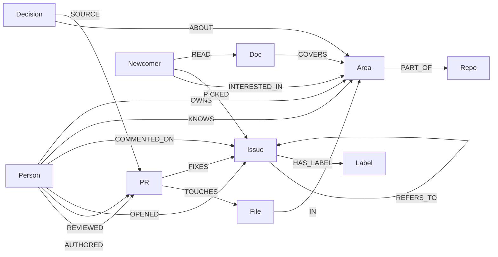

# Graph Hacks (FalkorDB): prep

Window: **Oct 15, 00:01 IST → Oct 18, 23:59 IST**. Submissions close at the end of the window. Progress: [#24](https://github.com/JannetEkka/DSProjects/issues/24). Page: [wemakedevs.org/hackathons/falkordb](https://wemakedevs.org/hackathons/falkordb) · [rules](https://wemakedevs.org/hackathons/falkordb/rules) · [resources](https://wemakedevs.org/hackathons/falkordb/resources).

Everything here is what rule 8 allows before the start: the idea, notes, a sketch of the graph model and diagrams. **No code is written before Oct 15, 00:01 IST.** The repo's first commit lands inside the window.

## Decision (2026-10-14, night)

The entry is now **Lore**. Jannet chose it from three new ideas, and chose the name. The earlier plan, Custody (a guard that checks each agent tool call for a path from untrusted content), was dropped for three reasons: it's a guard, not an agent that gets work done; its core idea is published research (DeepMind's CaMeL), so security-minded entrants will land near it; and each session's graph is tiny, so it shows little of what FalkorDB can do.

The other two ideas, kept for later:

- **Retraction Radar** (Track 01): "what breaks if this paper is retracted?" over the OpenAlex citation graph and the Crossref / Retraction Watch retraction list.
- **The Village Remembers** (Track 02): villager agents share one world graph, and what the player does spreads as gossip along their social links. Saved for a game jam, e.g. [Player2's AI NPC jams](https://itch.io/jam/player2-ai-npc-jam4) on itch.io, which come with a free LLM API for NPCs.

## Rules that shape the entry (read 2026-10-06, page re-checked 10-14)

- **Before the window:** only ideas, notes, the graph-model sketch and diagrams. "The main coding and design work must begin after the hackathon starts." Frameworks, open-source libraries, public APIs, templates and public datasets are fine.
- **FalkorDB has to do real work.** "If the product still works once FalkorDB is taken out, the graph is decoration." Docker, self-hosted and FalkorDB Cloud all count.
- **Data:** public, synthetic or our own. Nothing private, personal, paywalled or behind a login. Lore uses **public GitHub activity only** (see *Data* below), so nothing from SMT goes in.
- **Tracks:** enter one, two or all three, each with its own prize. Every track entered has to be named in the submission.
- **Submission:** a public repo; a README with setup steps **and the graph data model**; the Cypher queries or graph algorithms the product depends on; a demo video; a live deployment, or full local setup steps if it can't be deployed; the tracks entered.
- **AI coding assistants are allowed but must be disclosed.** Participants must be able to explain the graph model, the queries, the architecture and the decisions. A project "entirely generated using AI without meaningful participant contribution" may be rejected. See *Jannet's part* below.
- **Prizes:** devices, no cash: iPhone 18 Pro (Track 01), PS5 + GTA VI (Track 02), M6 Mac Mini (Track 03); AirPods 5 for the best blog post; a T-shirt for every member of the top 50 teams.
- No judging criteria are published. The page says rules can change before the start and changes are announced on the WeMakeDevs and FalkorDB channels.

## The entry: Lore

**Lore: what an open-source project knows but never wrote down.**

**Tracks: 03 (Company Brain), primary, and 01 (Agents That Act on Connected Data).** On Oct 17, decide whether the newcomer memory is strong enough to also name Track 02.

**The problem.** Someone wants to contribute to an open-source project, or a maintainer gets a new issue. The questions are the same: who knows this part of the code, why is it built this way, has this come up before, and who should look at it? The answers exist, spread across years of issues, PRs and review threads, but nobody can hold all of it in their head, and the docs never say who knows what.

**The idea.** Treat an open-source organisation as the company. It's the one kind of real organisation that does its internal work in public: who wrote what, who reviewed whom, and why a decision was made are all in issues and PRs anyone can read. Lore loads that history into FalkorDB, and an agent answers and acts on it.

**Main example: FalkorDB's own GitHub org** (the sponsor's project; the hackathon page links its repos). The repos are the teams, the contributors are the people, the issues and PRs are the work and the decisions. Users can pick any public org or repo instead (see *The product*).

**What the agent does:**

1. **Who knows this?** Ranks the people who know an area, with the PRs and reviews that prove it.
2. **Why is it like this?** Traces a decision back to the PR or issue where it was made, with a quoted excerpt and a link.
3. **Triage (the action).** For a new issue: related past issues and PRs, the area it touches, an active reviewer who knows that area, suggested labels, and a drafted reply with sources. **Dry run only on repos we don't own: it never posts on FalkorDB's repos.** Stretch: it posts for real on Lore's own repo.
4. **A newcomer's first contribution.** "I know Python and want to help with vector search" → the area → the closest open good-first-issue → the docs to read first → who reviews that area.
5. **Remembers each newcomer** across sessions: what they asked, read and picked up. Next time, it starts from there and says what changed since.
6. **Knowledge risk.** Areas that only one active person knows.

**Why the graph is the product (rule 3).** Every answer is a traversal: person → PR → file → area, issue → PR → issue, newcomer → area → issue. The "who knows" scores live on graph edges and the algorithms run in FalkorDB. Take FalkorDB out and the agent has nothing to answer from.

**How it maps to the tracks.** Track 03's list: knowledge from docs, tickets and chats in one graph (docs, issues, PR threads); who owns what and who knows what; tracing decisions to their source; keeping knowledge current (incremental sync); answers with clear sources. Track 01's list: multi-hop reasoning; graph queries and algorithms as agent tools; tool selection through MCP; actions based on the graph (triage); explainable results (every answer shows its path).

**Why it can win.** Most Track 03 entries will run on a fake company an LLM wrote; Lore runs on a real team's real history, mess included. The judges aren't named, but the sponsor's team will likely be among them, and they can check its answers because the project is theirs. Getting newcomers into open source is what WeMakeDevs is about. And it's a real tool afterwards: point it at any public GitHub project.

## The product (what people see and do)

**Who uses it.** Judges and visitors, who want to see it work in under a minute without signing up. Newcomers to a project, who want a first contribution and someone to ask. Maintainers, who want new issues triaged and to see where knowledge is thin.

### Where the data comes from

Lore reads GitHub's public API. When a project is picked, Lore fetches its PRs (with the files each one changed and who reviewed it), its issues (with labels and the links between them), and CODEOWNERS and docs where they exist. Each becomes nodes and edges in FalkorDB. Nothing is typed in by hand and nothing is made up: every name Lore shows is a GitHub login from that project's public history, with the PRs to prove it.

**A repo vs an org.** A repo is one codebase (github.com/FalkorDB/FalkorDB). An org is the account that holds a project's repos (github.com/FalkorDB holds the database, the browser, GraphRAG-SDK, the client libraries and more). Lore accepts either. With an org, each repo plays the part of a team, and people who work across repos are the links between teams.

**Any public project, chosen by the user.** Paste an org or repo URL and Lore builds its graph. Size caps keep a build to a few minutes: the last 12 months, the most active repos (about 10 at most), about 500 PRs per repo. The numbers are set on day 1 after timing FalkorDB's build. Private repos are impossible by construction: Lore's GitHub access is public-read only.

**Ready-made projects,** so nobody waits: FalkorDB (the main example) and one or two others, built ahead of time and kept in sync.

### Pages

1. **Landing:** one line on what Lore does, a short looping clip, and two buttons: *Try it on FalkorDB (no sign-in)* and *Sign in with GitHub to add your own project*. Below: the three things it does, with a screenshot each.
2. **How to use:** a first-visit tour (four steps, skippable) and a 60-second video, always reachable from the help button.
3. **Workspace,** the main screen. Top bar: project picker (ready-made, your own, *Add a project*), model picker, sign-in. Middle: tabs **Ask**, **Triage an issue**, **First contribution**, **Knowledge risk**, **Teams**. Right: the **Under the hood** panel while Lore works, then **Proof** when the answer lands.
4. **Add a project:** paste a URL; Lore checks the size and shows an estimate, then builds with a live progress view (repos read, PRs read, people found, nodes and edges created) and opens the workspace.
5. **How it works:** the graph model, what's kept and what isn't, the scoring rule, the Cypher, the algorithms and the backtest. The page for a technical check (submission rule 10); it mirrors the README.
6. **My memory:** what Lore remembers about you (interests, questions, the issue you picked), with one button that deletes it all.

### The main flows

- **Ask:** type a question or tap a suggested one ("Who knows the query planner?", "Why does FalkorDB do X?").
- **Triage an issue:** pick from the project's open issues (newest, unlabelled, no reply yet) or paste an issue URL. Out come related past issues and PRs, the area, an active reviewer, labels and a draft reply, with a *dry run* badge and a *Copy reply* button. Lore never posts on anyone's repo.
- **First contribution:** say what you know and what interests you; get the docs to read, a good first issue near that interest, and who reviews that area. It's saved to your memory, and the next visit starts with what changed.
- **Knowledge risk:** areas only one active person knows, as a map.
- **Teams:** who actually works together, from community detection over who reviews whom.

### Under the hood, then Proof

While Lore works, the right panel shows each step as it happens: the tool it chose, the Cypher it ran, how many nodes came back, and the part of the graph being searched lighting up. When the answer lands, the panel switches to **Proof**: the evidence path drawn as a graph, each name with the PRs and reviews behind it, every claim linked to the GitHub page it came from. Nothing appears without a source.

### Sign in

**Sign in with GitHub** is login and registration in one step, with no passwords to store. It's needed for three things:

- **Adding your own project.** Building a graph takes many GitHub API calls. GitHub allows 60 an hour without a login and 5,000 an hour with one, so signing in brings your own allowance.
- **Memory.** Lore has to know it's you to remember you across sessions: one memory per user (Track 02).
- **Public only.** The sign-in asks for no permissions, so Lore can only ever read public data.

Guests can do everything on the ready-made projects; only adding a project and memory need a sign-in. Lore stores the GitHub login and nothing else (no email).

**Jannet's one task for this:** create a GitHub OAuth app (GitHub → Settings → Developer settings → OAuth Apps → New, about 3 minutes, once the deploy URL exists on Oct 17) and put its two values in the host's environment settings, never in chat.

### Models

- **Model picker:** lists the Gemini models the key can actually use, fetched from Google at startup rather than hard-coded, with a recommended default.
- **Automatic fallback:** each Gemini model has its own free limit. When the chosen one runs out, Lore moves to the next free model and says so in the Under the hood panel.
- **Your own key (optional):** paste your own free Gemini key to use your own quota. It's used for that request only and never stored.
- **Saved answers** for the suggested questions on the ready-made projects, so guests see a full demo even if every free limit is used up.

### Hosting

Decided on day 1, free only. Render's free plan has 512 MB of memory and sleeps after 15 idle minutes; a free Hugging Face Space has much more memory and suits a graph better. Ready-made graphs ship with the app so a restart doesn't lose them. FalkorDB Cloud's free tier keeps user-added graphs, if it needs no card.

### What gets built first

| Priority | Parts |
|---|---|
| **Must** (by Oct 17) | Landing; workspace on the ready-made FalkorDB graph; Ask, Triage and First contribution with Under the hood and Proof; model picker with fallback; How it works page; live deploy |
| **Should** | Sign in with GitHub; Add a project with live progress; My memory; the tour; Knowledge risk and Teams; MCP server |
| **Could** | Your own key; a third ready-made project |

If time runs short, the Must row ships complete before anything in the Should row starts.

## Data

- **Source:** GitHub's public API for the org's public repos: issues, PRs, reviews, review comments, files changed, labels, and CODEOWNERS where present. The docs repo gives the Doc nodes.
- **Repos:** the active ones (core FalkorDB, falkordb-browser, GraphRAG-SDK, QueryWeaver, code-graph, the client libraries, docs). The final list is picked by activity on Oct 15.
- **Kept:** public GitHub logins, issue and PR numbers, titles, dates, states, labels, file paths, and short excerpts of discussion text where a decision was made, always with the link.
- **Not kept:** emails (git commit emails are dropped), real names, avatars, anything from outside GitHub (no Discord, which needs a login).
- **Fresh:** incremental sync by `updated_at`, so issues opened during the hackathon show up in the demo.
- **Respect:** knowledge risk is shown per area, never as "what if this person leaves", and people are never ranked by worth, only by evidence of who worked on what.

## Graph model (sketch)

- **Person:** a GitHub login. Nothing else about them.
- **Repo:** one per repository; it plays the part of a team.
- **Area:** a directory at a fixed depth (say `src/index` or `src/execution_plan`), the unit of "who knows". Each File sits in one Area.
- **Issue, PR:** number, title, state, dates, URL. PR `FIXES` Issue comes from "Fixes #123"; `REFERS_TO` from cross-references.
- **Decision:** a choice and its reason, pulled out of PR descriptions and review threads by the LLM. Each has a `SOURCE` edge to the PR or issue where it was said, plus the quoted excerpt. A decision with no source is never stored.
- **KNOWS:** a derived edge with a score and a last-active date, recomputed on every sync (scoring rule below).
- **OWNS:** from CODEOWNERS, where the repo has one.
- **Doc:** a docs page and the areas it covers.
- **Newcomer:** someone using Lore, with their own memory: interests, docs read, issue picked, questions asked.
- **One graph per org** (FalkorDB's multi-graph), so a second org gets its own isolated graph.

## The scoring rule (Jannet signs off)

`KNOWS(person, area)` adds up that person's work in the area: an authored, merged PR counts 1.0, a review 0.6, an issue or PR comment 0.2. Each is multiplied by a recency decay with a half-life of 180 days. "Active" means any activity in the org in the last 90 days. Triage suggests the highest-scoring active person who isn't the issue's author.

These weights are a starting guess. The backtest tunes them, and the README reports what changed and why.

## Questions the graph answers (Cypher written in the window)

1. Who knows area X? Ranked, with the evidence path person → PR → file → area.
2. Why is X built this way? Decisions about the area, each with its source and the chain of issues it fixed or referred to.
3. Which past issues and PRs relate to this new issue? Shared areas, labels and references, followed several hops.
4. Who should review it? The top active `KNOWS` for the issue's areas.
5. What's a good first contribution for this newcomer? The shortest path from their interest to an open good-first-issue, the docs covering that area, and its reviewer.
6. Which areas does only one active person know?
7. Who actually works together? Community detection over who-reviews-whom: the real teams, which no org chart shows.
8. Who holds the project together? PageRank and betweenness over the review graph.
9. What changed since this newcomer's last visit?

## Proof it works

**Backtest on history.** For PRs merged in the last 6 months, rebuild the graph as it stood the day each PR was opened, predict its reviewers, and compare with who actually reviewed it. Report top-1 and top-3 hit rates for Lore and three baselines: the repo's most frequent reviewer; the last person to touch the same files; and the LLM alone, given the PR title and the list of contributors.

A second check if the data allows it: for issues closed as duplicates, does Lore's related-issues query find the original in its top 5? The misses go in the README too.

## Stack (free only)

- **FalkorDB:** FalkorDBLite (embedded, already confirmed to run in the cloud session) or Docker. FalkorDB Browser for the video.
- **Python:** the `falkordb` client, FastAPI, and a small web page that draws evidence paths (Cytoscape.js from a CDN).
- **Gemini** (free key, `GEMINI_API_KEY` in the cloud environment): turns questions into graph tool calls, pulls decisions out of threads, drafts triage replies. The graph queries are the tools; the LLM never states anything the graph can't back.
- **MCP server** with the graph tools (`who_knows`, `why`, `triage`, `newcomer_path`, `knowledge_risk`), so any agent can use Lore. A *Should*, built once the Must row is done.
- **Live deployment:** see *The product → Hosting*. If no free host works: full local setup steps plus the video, which the rules accept.

## Build plan (Jannet away Oct 15–18, laptop mornings and nights only)

| Day (IST) | Claude builds | Jannet (minutes, phone OK) |
|---|---|---|
| Oct 15 | Public repo `lore` under JannetEkka; GitHub ingestion for any public org or repo, with the size caps, timed on FalkorDB's org; schema; `KNOWS` scoring; questions 1, 3, 4 and 6; tests; `EXPLAIN.md` | Night: read `EXPLAIN.md` (graph model and scoring) and reply with questions |
| Oct 16 | Agent on Gemini with the graph tools; model picker and fallback; the Under the hood step stream; decisions with sources (question 2); triage; first contribution and memory; incremental sync; first version of the workspace | Night: open the preview link and ask Lore three questions about FalkorDB |
| Oct 17 | Landing, How it works, the tour; live deploy; then the Should row (Sign in with GitHub, Add a project, My memory, Knowledge risk, Teams, MCP); backtest and baselines; README with data model and Cypher; demo questions picked and every answer checked on GitHub; Track 02 decision | Once the deploy URL exists: create the GitHub OAuth app (about 3 min). Night: look at the backtest numbers and the demo questions |
| Oct 18 | Screen recording; video script by noon; video cut with Jannet's clips (or synthetic voice); blog post draft; submission text in #24 by **18:00 IST** | Afternoon: record one voice clip per script row (about 10 min). Night: watch the video, then submit before **23:59 IST** |

The project repo is new and public, and the build pushes straight to its `main` so judges see a commit history inside the window. If the repo can't be created from the cloud session, Jannet creates an empty public one (a minute on the phone).

## Where the build runs

This session started before `GEMINI_API_KEY` was added to the cloud environment, so it can't see the key; only sessions started after it was added can. At 00:02 IST it re-reads the rules and starts a fresh session in the same environment for the build, briefed from this file. Status stays in #24.

## Demo

Two parts, both required: a video of about 3 minutes, and a live link where judges ask their own questions.

**The rule for every answer on camera:** the questions are picked on Oct 17, after the data is loaded, and every answer shown is checked against GitHub first. The judges know their own project, so one wrong name costs more than any feature adds.

### The video (about 3 minutes)

| Time | On screen | What it proves |
|---|---|---|
| 0:00 | The landing page, then FalkorDB's GitHub org and its counts (repos, contributors, issues, PRs). "You want to help. Where do you start, and who do you ask?" | The problem, on a real project |
| 0:15 | **The LLM alone vs Lore.** Gemini on its own is asked "who should review a change to the vector index?" and guesses. Lore gets the same question: the Under the hood panel shows each step (tool chosen, Cypher run, nodes found) with the graph lighting up, then Proof names people, each with the PRs and reviews behind them | The graph is what makes the answer right (rule 3); every answer shows its path (Track 01) |
| 0:45 | "Why does FalkorDB do X?" The decision, the quote, the link; click through to the real PR on GitHub | Decisions traced to their source (Track 03) |
| 1:10 | **An issue opened on FalkorDB this week, during the hackathon.** Lore's triage draft: related past issues, the area, an active reviewer, labels, a reply with sources. A "dry run" badge: nothing is posted | It acts on what the graph shows, and the graph is current (Tracks 01 and 03) |
| 1:35 | A newcomer: "I know Python and want to help with vector search" gets docs to read, a good first issue and a reviewer. New session: "I'm back." Lore remembers them and says what changed since | Memory across sessions |
| 2:00 | The graph itself in FalkorDB Browser, the "who knows" Cypher on screen, and the Teams tab: community detection showing who actually works together | The Cypher and algorithms the product runs on (submission rule 10) |
| 2:20 | The backtest table: how often Lore's top 3 contains the person who really reviewed, against the baselines, misses included. Five seconds of an editor agent calling Lore's MCP tools | Honest numbers; MCP tool use (Track 01) |
| 2:40 | **Your own project:** sign in with GitHub, paste another public repo, and watch its graph build live (sped up), then ask it one question. Repo link, live link, tracks | It works on any public project, not only the example |

Fallback for 1:10: if FalkorDB gets no new issue during Oct 15–18, use their most recent one and say when it was opened.

**Voice.** Jannet's own voice is better than a synthetic one: judges hear that she knows the project (rules 12–13). The script is ready by Oct 18 noon; she records one short clip per row on her phone (about 10 minutes in all), and Claude lines them up with the screen recording. Fallback: synthetic narration via [tools/demo-video](../tools/demo-video/). Claude records the screen in a headless browser either way.

### The live link

The live link is the whole product (see *The product*). A judge lands on the landing page, taps *Try it on FalkorDB*, and can ask, triage and plan a first contribution without signing in. Signing in with GitHub adds their own project and memory. Saved answers for the suggested questions keep it working when free Gemini limits run out. If the host sleeps when idle, the first load is slow, and the README says so, as Wiretrap's does.

## Jannet's part (rules 11–13)

Jannet chose the idea and the name (Oct 14, from three options). She signs off on the graph model and the scoring rule above, set the product requirements (landing, sign-in, tour, project and model pickers, the Under the hood panel), reads `EXPLAIN.md` on day 1, checks the backtest on day 3, and must be able to explain the model, the "who knows" query and the trade-offs. Disclosure for the submission:

> Built with Claude Code as the coding assistant. I chose the problem, the graph model and the scoring rule, and I reviewed the code, tests and backtest. All data is public GitHub activity; no emails or private data.

## Risks

- **GitHub API access** from the cloud session may be limited. If so, Jannet adds a fine-grained, read-only token (public repos only) to the environment.
- **The Gemini key** isn't in the usual AI Studio format. The build session checks it works with the Gemini API, on the free tier, before relying on it.
- **Wrong answers about the judges' own project.** Every answer in the demo is checked against the repo, and the backtest reports misses.
- **Rate limits:** ingestion is cached, and the deploy runs on a snapshot.
- **Scope.** The product is big for four days. The Must row ships complete before the Should row starts, and the video only shows what works.
- **GitHub limits for user-added projects:** the size caps keep a build within one signed-in user's hourly allowance; a build that would go over says so before it starts.
- **Rules can change before the start:** re-read at window open.
