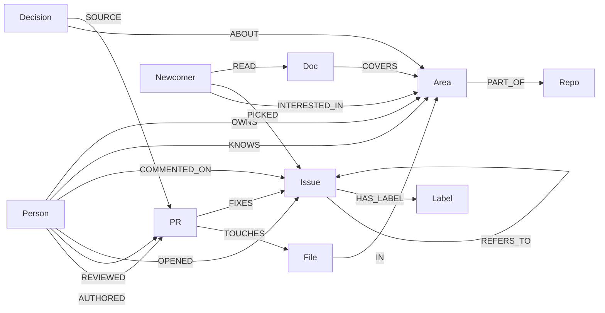

# Graph Hacks (FalkorDB): prep

Window: **Oct 15, 00:01 IST → Oct 18, 23:59 IST**. Submissions close at the end of the window. Progress: [#24](https://github.com/JannetEkka/DSProjects/issues/24). Page: [wemakedevs.org/hackathons/falkordb](https://wemakedevs.org/hackathons/falkordb) · [rules](https://wemakedevs.org/hackathons/falkordb/rules) · [resources](https://wemakedevs.org/hackathons/falkordb/resources).

Everything here is what rule 8 allows before the start: the idea, notes, a sketch of the graph model and diagrams. **No code is written before Oct 15, 00:01 IST.** The repo's first commit lands inside the window.

## Decision (2026-10-14, night)

The entry is now **Lore**. Jannet chose it from three new ideas, and chose the name. The earlier plan, Custody (a guard that checks each agent tool call for a path from untrusted content), was dropped for three reasons: it's a guard, not an agent that gets work done; its core idea is published research (DeepMind's CaMeL), so security-minded entrants will land near it; and each session's graph is tiny, so it shows little of what FalkorDB can do.

The other two ideas, kept for later:

- **Retraction Radar** (Track 01): "what breaks if this paper is retracted?" over the OpenAlex citation graph and the Crossref / Retraction Watch retraction list.
- **The Village Remembers** (Track 02): villager agents share one world graph, and what the player does spreads as gossip along their social links. Saved for a game jam, e.g. [Player2's AI NPC jams](https://itch.io/jam/player2-ai-npc-jam4) on itch.io, which come with a free LLM API for NPCs.

## Rules that shape the entry (read 2026-10-06, page re-checked 10-14)

- **Before the window:** only ideas, notes, the graph-model sketch and diagrams. "The main coding and design work must begin after the hackathon starts." Frameworks, open-source libraries, public APIs, templates and public datasets are fine.
- **FalkorDB has to do real work.** "If the product still works once FalkorDB is taken out, the graph is decoration." Docker, self-hosted and FalkorDB Cloud all count.
- **Data:** public, synthetic or our own. Nothing private, personal, paywalled or behind a login. Lore uses **public GitHub activity only** (see *Data* below), so nothing from SMT goes in.
- **Tracks:** enter one, two or all three, each with its own prize. Every track entered has to be named in the submission.
- **Submission:** a public repo; a README with setup steps **and the graph data model**; the Cypher queries or graph algorithms the product depends on; a demo video; a live deployment, or full local setup steps if it can't be deployed; the tracks entered.
- **AI coding assistants are allowed but must be disclosed.** Participants must be able to explain the graph model, the queries, the architecture and the decisions. A project "entirely generated using AI without meaningful participant contribution" may be rejected. See *Jannet's part* below.
- **Prizes:** devices, no cash: iPhone 18 Pro (Track 01), PS5 + GTA VI (Track 02), M6 Mac Mini (Track 03); AirPods 5 for the best blog post; a T-shirt for every member of the top 50 teams.
- No judging criteria are published. The page says rules can change before the start and changes are announced on the WeMakeDevs and FalkorDB channels.

## The entry: Lore

**Lore: what an open-source project knows but never wrote down.**

**Tracks: 03 (Company Brain), primary, and 01 (Agents That Act on Connected Data).** On Oct 17, decide whether the newcomer memory is strong enough to also name Track 02.

**The problem.** Someone wants to contribute to an open-source project, or a maintainer gets a new issue. The questions are the same: who knows this part of the code, why is it built this way, has this come up before, and who should look at it? The answers exist, spread across years of issues, PRs and review threads, but nobody can hold all of it in their head, and the docs never say who knows what.

**The idea.** Treat an open-source organisation as the company. It's the one kind of real organisation that does its internal work in public: who wrote what, who reviewed whom, and why a decision was made are all in issues and PRs anyone can read. Lore loads that history into FalkorDB, and an agent answers and acts on it.

**Demo org: FalkorDB's own GitHub org.** The repos are the teams, the contributors are the people, the issues and PRs are the work and the decisions. A second org in the video shows it works anywhere (WeMakeDevs' org if it has enough activity, otherwise another mid-sized one).

**What the agent does:**

1. **Who knows this?** Ranks the people who know an area, with the PRs and reviews that prove it.
2. **Why is it like this?** Traces a decision back to the PR or issue where it was made, with a quoted excerpt and a link.
3. **Triage (the action).** For a new issue: related past issues and PRs, the area it touches, an active reviewer who knows that area, suggested labels, and a drafted reply with sources. **Dry run only on repos we don't own: it never posts on FalkorDB's repos.** Stretch: it posts for real on Lore's own repo.
4. **A newcomer's first contribution.** "I know Python and want to help with vector search" → the area → the closest open good-first-issue → the docs to read first → who reviews that area.
5. **Remembers each newcomer** across sessions: what they asked, read and picked up. Next time, it starts from there and says what changed since.
6. **Knowledge risk.** Areas that only one active person knows.

**Why the graph is the product (rule 3).** Every answer is a traversal: person → PR → file → area, issue → PR → issue, newcomer → area → issue. The "who knows" scores live on graph edges and the algorithms run in FalkorDB. Take FalkorDB out and the agent has nothing to answer from.

**How it maps to the tracks.** Track 03's list: knowledge from docs, tickets and chats in one graph (docs, issues, PR threads); who owns what and who knows what; tracing decisions to their source; keeping knowledge current (incremental sync); answers with clear sources. Track 01's list: multi-hop reasoning; graph queries and algorithms as agent tools; tool selection through MCP; actions based on the graph (triage); explainable results (every answer shows its path).

**Why it can win.** Most Track 03 entries will run on a fake company an LLM wrote; Lore runs on a real team's real history, mess included. The judges can check its answers because the project is theirs. Getting newcomers into open source is what WeMakeDevs is about. And it's a real tool afterwards: point it at any GitHub org.

## Data

- **Source:** GitHub's public API for the org's public repos: issues, PRs, reviews, review comments, files changed, labels, and CODEOWNERS where present. The docs repo gives the Doc nodes.
- **Repos:** the active ones (core FalkorDB, falkordb-browser, GraphRAG-SDK, QueryWeaver, code-graph, the client libraries, docs). The final list is picked by activity on Oct 15.
- **Kept:** public GitHub logins, issue and PR numbers, titles, dates, states, labels, file paths, and short excerpts of discussion text where a decision was made, always with the link.
- **Not kept:** emails (git commit emails are dropped), real names, avatars, anything from outside GitHub (no Discord, which needs a login).
- **Fresh:** incremental sync by `updated_at`, so issues opened during the hackathon show up in the demo.
- **Respect:** knowledge risk is shown per area, never as "what if this person leaves", and people are never ranked by worth, only by evidence of who worked on what.

## Graph model (sketch)

- **Person:** a GitHub login. Nothing else about them.
- **Repo:** one per repository; it plays the part of a team.
- **Area:** a directory at a fixed depth (say `src/index` or `src/execution_plan`), the unit of "who knows". Each File sits in one Area.
- **Issue, PR:** number, title, state, dates, URL. PR `FIXES` Issue comes from "Fixes #123"; `REFERS_TO` from cross-references.
- **Decision:** a choice and its reason, pulled out of PR descriptions and review threads by the LLM. Each has a `SOURCE` edge to the PR or issue where it was said, plus the quoted excerpt. A decision with no source is never stored.
- **KNOWS:** a derived edge with a score and a last-active date, recomputed on every sync (scoring rule below).
- **OWNS:** from CODEOWNERS, where the repo has one.
- **Doc:** a docs page and the areas it covers.
- **Newcomer:** someone using Lore, with their own memory: interests, docs read, issue picked, questions asked.
- **One graph per org** (FalkorDB's multi-graph), so a second org gets its own isolated graph.

## The scoring rule (Jannet signs off)

`KNOWS(person, area)` adds up that person's work in the area: an authored, merged PR counts 1.0, a review 0.6, an issue or PR comment 0.2. Each is multiplied by a recency decay with a half-life of 180 days. "Active" means any activity in the org in the last 90 days. Triage suggests the highest-scoring active person who isn't the issue's author.

These weights are a starting guess. The backtest tunes them, and the README reports what changed and why.

## Questions the graph answers (Cypher written in the window)

1. Who knows area X? Ranked, with the evidence path person → PR → file → area.
2. Why is X built this way? Decisions about the area, each with its source and the chain of issues it fixed or referred to.
3. Which past issues and PRs relate to this new issue? Shared areas, labels and references, followed several hops.
4. Who should review it? The top active `KNOWS` for the issue's areas.
5. What's a good first contribution for this newcomer? The shortest path from their interest to an open good-first-issue, the docs covering that area, and its reviewer.
6. Which areas does only one active person know?
7. Who actually works together? Community detection over who-reviews-whom: the real teams, which no org chart shows.
8. Who holds the project together? PageRank and betweenness over the review graph.
9. What changed since this newcomer's last visit?

## Proof it works

**Backtest on history.** For PRs merged in the last 6 months, rebuild the graph as it stood the day each PR was opened, predict its reviewers, and compare with who actually reviewed it. Report top-1 and top-3 hit rates for Lore and three baselines: the repo's most frequent reviewer; the last person to touch the same files; and the LLM alone, given the PR title and the list of contributors.

A second check if the data allows it: for issues closed as duplicates, does Lore's related-issues query find the original in its top 5? The misses go in the README too.

## Stack (free only)

- **FalkorDB:** FalkorDBLite (embedded, already confirmed to run in the cloud session) or Docker. FalkorDB Browser for the video.
- **Python:** the `falkordb` client, FastAPI, and a small web page that draws evidence paths (Cytoscape.js from a CDN).
- **Gemini** (free key, `GEMINI_API_KEY` in the cloud environment): turns questions into graph tool calls, pulls decisions out of threads, drafts triage replies. The graph queries are the tools; the LLM never states anything the graph can't back.
- **MCP server** with the graph tools (`who_knows`, `why`, `triage`, `newcomer_path`, `knowledge_risk`), so any agent can use Lore. Day 2.
- **Live deployment:** Render's free tier, running on a snapshot of the graph so the public demo needs no GitHub token. If Render won't work: full local setup steps plus the video.

## Build plan (Jannet away Oct 15–18, laptop mornings and nights only)

| Day (IST) | Claude builds | Jannet (minutes, phone OK) |
|---|---|---|
| Oct 15 | Public repo `lore` under JannetEkka; GitHub ingestion for the FalkorDB org; schema; `KNOWS` scoring; questions 1, 3, 4 and 6; tests | Night: read `EXPLAIN.md` (graph model and scoring) and reply with questions |
| Oct 16 | Agent on Gemini with the graph tools; decisions with sources (question 2); triage; newcomer path and memory; incremental sync; MCP server | Night: ask Lore three questions about FalkorDB |
| Oct 17 | Web UI with evidence paths; backtest and baselines; questions 7 and 8; README with data model and Cypher; Render deploy; Track 02 decision | Night: look at the backtest numbers |
| Oct 18 | Demo video recorded and narrated; blog post draft; submission text in #24 by **18:00 IST** | Night: watch the video, then submit before **23:59 IST** |

The project repo is new and public, and the build pushes straight to its `main` so judges see a commit history inside the window. If the repo can't be created from the cloud session, Jannet creates an empty public one (a minute on the phone).

## Where the build runs

This session started before `GEMINI_API_KEY` was added to the cloud environment, so it can't see the key; only sessions started after it was added can. At 00:02 IST it re-reads the rules and starts a fresh session in the same environment for the build, briefed from this file. Status stays in #24.

## Demo video (about 2½ minutes)

1. 0:00. "You want to contribute to FalkorDB. Where do you start, and who do you ask?"
2. 0:15. Who knows a part of the code: ranked people, with the PRs that prove it.
3. 0:40. Why FalkorDB does something a certain way: the decision, the quote, the link to the PR.
4. 1:05. A real issue opened this week: the triage draft with related issues, area, reviewer and reply (dry run).
5. 1:30. A newcomer gets a first-contribution plan; in a new session, Lore remembers them.
6. 1:55. The graph in FalkorDB Browser, and the one Cypher query behind "who knows".
7. 2:10. Backtest table, a second org, the repo link.

Recorded by Claude in a headless browser and narrated with a synthetic voice ([tools/demo-video](../tools/demo-video/)). Jannet can record her own voice over it instead.

## Jannet's part (rules 11–13)

Jannet chose the idea and the name (Oct 14, from three options). She signs off on the graph model and the scoring rule above, reads `EXPLAIN.md` on day 1, checks the backtest on day 3, and must be able to explain the model, the "who knows" query and the trade-offs. Disclosure for the submission:

> Built with Claude Code as the coding assistant. I chose the problem, the graph model and the scoring rule, and I reviewed the code, tests and backtest. All data is public GitHub activity; no emails or private data.

## Risks

- **GitHub API access** from the cloud session may be limited. If so, Jannet adds a fine-grained, read-only token (public repos only) to the environment.
- **The Gemini key** isn't in the usual AI Studio format. The build session checks it works with the Gemini API, on the free tier, before relying on it.
- **Wrong answers about the judges' own project.** Every answer in the demo is checked against the repo, and the backtest reports misses.
- **Rate limits:** ingestion is cached, and the deploy runs on a snapshot.
- **Rules can change before the start:** re-read at window open.
