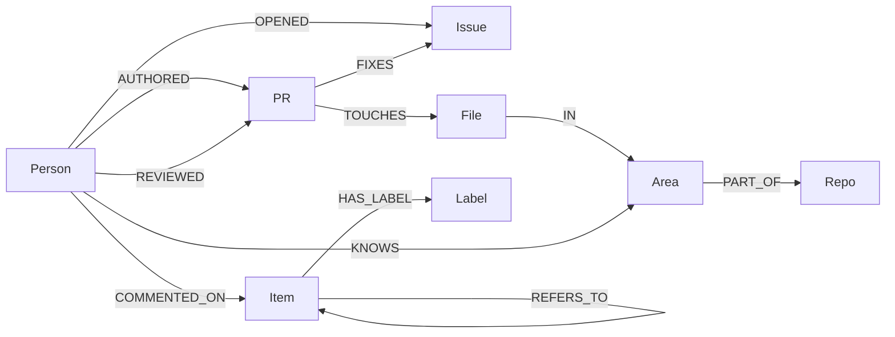

# How Lore works

This is the page to read before explaining Lore to anyone: the graph, the scoring rule, the queries, and the limits. Every number here comes from the code in `lore/` and the tests in `tests/`.

## In one minute

Lore turns a public GitHub project's history into a graph in FalkorDB, then answers from it: who knows this part of the code, which past issues relate to a new one, who should look at it, and which parts only one active person knows. Every answer comes with the PRs behind it and the Cypher that produced it.

## Where the data comes from

| Source | What it gives | Cost |
|---|---|---|
| GitHub REST API, bulk endpoints (100 items a call) | PRs, issues, review comments, conversation comments | 60 calls an hour without a token, 5,000 with one |
| GitHub REST API, one call per merged PR (token only) | approvals and change requests | 1 call per PR |
| `git clone --filter=blob:none` (history and file lists, no file contents) | the files each merged PR changed | no API calls |

The git trick: when a project squash-merges, each commit subject ends in the PR number, like `fix: plan a self-loop hop (#3102)`. A merge commit says `Merge pull request #7 from ...`. So `git log --first-parent -m --name-only` maps every merged PR to its files without spending GitHub's allowance.

**What's kept:** GitHub logins, issue and PR numbers, titles, dates, labels, file paths, and the first 2,000 characters of an issue's text. **Never kept:** emails or real names. Bots (`[bot]` accounts, dependabot and similar) are skipped. Copied-in code (`deps/`, `vendor/`, `third_party/`, `node_modules/`) and lock files are ignored, because who edits them says little about who knows the project.

## The graph



| Node | What it is | Key properties |
|---|---|---|
| `Person` | a GitHub login | `login`, `last_active`, `active` (any activity in the last 90 days) |
| `PR`, `Issue` | both also carry the label `Item`, because a reference can point at either | `id` (`owner/repo#123`), `title`, `state`, dates, `url` |
| `File` | a path in a repo | `id` (`owner/repo:path`), `path` |
| `Area` | a directory two levels deep: `src/index/vector.c` → `src/index` | `id`, `path`, `repo` |
| `Repo` | one repository; in an org, it plays the part of a team | `name`, `url` |
| `Label` | a GitHub label, per repo | `name` |

Edges worth knowing: `REVIEWED` has `state` (strongest of APPROVED > CHANGES_REQUESTED > COMMENTED), `at` and `count`. `COMMENTED_ON` has `count` and `last_at`. `FIXES` comes from "Fixes #12" in a PR; `REFERS_TO` from any other "#12". `KNOWS` is computed, not fetched (next section).

**Why an area is a directory.** People know modules, not single files, and a whole repo is too coarse to route an issue. Two levels deep fits most layouts (`src/index`, `tests/flow`). A Java-style `src/main/java/...` layout would need a deeper setting (`AREA_DEPTH` in `lore/config.py`).

**One graph per project.** FalkorDB holds many isolated graphs in one instance, so each org or repo gets its own (`FalkorDB`, `owner__repo`).

## The scoring rule: KNOWS(person, area)

Every piece of work in an area adds to the score:

| Work | Weight |
|---|---|
| wrote a PR that was merged | 1.0 |
| reviewed a PR (approval, change request or review comment) | 0.6 |
| commented on a PR, or on an issue that a PR then fixed | 0.2 |

Each weight is multiplied by a recency decay that halves every 180 days: `weight × 0.5^(age in days / 180)`. A PR counts once per area however many files it touched. Open PRs count for nothing: only merged code. Authors don't get comment credit on their own PRs.

**Worked example (from `tests/test_graph.py`):**
- alice merged PR 10 ten days ago and PR 11 two hundred days ago, both in `src/index`: 1.0 × 0.962 + 1.0 × 0.463 = **1.43**
- bob approved PR 10 nine days ago, and commented on issue #1, which PR 10 fixed: 0.6 × 0.966 + 0.2 × 0.955 = **0.77**
- dave's only PR there is 300 days old: **0.31**, and with no activity in 90 days he is inactive, so Lore never suggests him as a reviewer

The scores are computed inside FalkorDB, one query per kind of work. The one for authored PRs:

```cypher
MATCH (p:Person)-[:AUTHORED]->(pr:PR)-[:TOUCHES]->(:File)-[:IN]->(a:Area)
WHERE pr.merged_at IS NOT NULL
WITH DISTINCT p, pr, a, pr.merged_at AS at                -- one row per person, PR and area
WITH p, a, sum($w * exp($k * ($now - at))) AS s,          -- weight × decay, summed
     count(pr) AS n, max(at) AS last
MERGE (p)-[k:KNOWS]->(a)
ON CREATE SET k.score = s, k.authored = n, k.last_at = last
ON MATCH SET k.score = k.score + s, k.authored = n, ...
```

`$k` is `-ln 2 / (180 days in seconds)`, so `exp($k × age)` is the same halving curve. The comment query walks one hop further: a comment on an issue counts towards the areas of the PR that fixed it (`(n)<-[:FIXES*0..1]-(pr:PR)`).

The weights are a starting guess. The backtest (does Lore pick the people who really reviewed past PRs?) is what tunes them.

## The questions (`lore/queries.py`)

**1. Who knows this area?** Find the matching areas, sum each person's `KNOWS` over them, rank. Then, per person, the three most recent PRs they wrote or reviewed there, as evidence.

```cypher
MATCH (a:Area) WHERE a.id IN $areas OR ($term <> '' AND toLower(a.path) CONTAINS toLower($term))
MATCH (p:Person)-[k:KNOWS]->(a)
WITH p, sum(k.score) AS score, collect(a.path) AS areas, max(k.last_at) AS last_at
RETURN p.login AS login, score, areas, last_at, p.active AS active
ORDER BY score DESC LIMIT $limit
```

**Which areas is an issue about?** (used by 3 and 4) Three signals, each with its reason shown:

| Signal | Score |
|---|---|
| PRs that fixed this issue touched the area | 3 per PR |
| past issues with the same label were fixed in that area (5 hops: issue → label → other issue → fixing PR → file → area) | 2 × share of that label's fixes, only if the share is at least 20% |
| the issue's words name the area's directory, or a file in it | 1 per directory name, 0.5 per file word (at most 3) |

The share rule stops a generic label like `bug` from pointing everywhere.

**3. Related issues and PRs.** Items linked directly, up to two hops (issue → PR that fixed it, issue → issue it mentions): 3 each. Issues fixed in the same areas: 1.5 per shared area. Similar titles: 2 × word overlap (Jaccard), from 25% overlap up.

**4. Who should look at this issue?** Active people (activity in the last 90 days), never the issue's author, ranked by `KNOWS` summed over the issue's areas, each with evidence.

**6. Knowledge risk.** Areas with at least 3 merged PRs in the last 180 days that at most one active person knows well (`KNOWS` of at least 1.0). It shows areas, never "what if this person leaves".

Every question records its queries in a `Trace` (step, Cypher, rows, milliseconds). That's what the app's "Under the hood" panel shows. Try `python -m lore who-knows <graph> index --trace`.

## Limits (say them before a judge finds them)

- **Without a token there are no approvals**, only review comments. A reviewer who approves without commenting is missed. With `GITHUB_TOKEN` set, approvals are fetched too.
- **PRs need a "(#123)" subject or a merge commit** to be tied to files. Direct pushes to the main branch are ignored.
- **Word matching for an issue's areas is crude.** Gemini will do this part better; the graph signals stay as the check on it.
- **Twelve months of history** by default, with caps per repo (500 PRs, 500 issues, 1,000 comments of each kind), so a build stays within an hour of GitHub's allowance.
- **Logins are stored.** They're public, but Lore still shows only evidence of work, never a ranking of people's worth.

## Questions a judge might ask

- **Why a graph and not SQL?** "Who should review this issue?" is issue → PR that fixed it → files → area → people who know it → their recent PRs. That's five joins in SQL and one pattern here, and the label signal is a five-hop pattern on its own. PageRank and community detection run inside FalkorDB too.
- **What breaks without FalkorDB?** Everything. `KNOWS` is computed in the graph and every answer is a traversal; there's no other store.
- **How do you know the answers are right?** Tests on a small fixture with hand-computed scores, and a backtest on real history: for past PRs, would Lore have named the people who actually reviewed them?
- **Why decay?** Someone who rewrote the planner three years ago may not remember it; last month's work counts more.
- **Privacy?** Public data only, logins only, no emails, bots skipped.

## Run it

```bash
python -m venv .venv && . .venv/bin/activate
pip install -r requirements.txt
python -m pytest -q                                   # 12 tests, embedded FalkorDB, no setup
python -m lore fetch FalkorDB/FalkorDB                # optional: export GITHUB_TOKEN=... first
python -m lore load data/FalkorDB__FalkorDB.json
python -m lore who-knows FalkorDB/FalkorDB index --trace
```

Without `FALKORDB_HOST`, Lore runs FalkorDB embedded (FalkorDBLite) with the data in `data/lore.rdb`. Set `FALKORDB_HOST` (and `FALKORDB_PORT`, `FALKORDB_PASSWORD`) to use a server or FalkorDB Cloud.
